<a href="README.tr.md">Türkçe</a> · <a href="README.md">English</a> · <a href="README.es.md">Español</a> · <a href="README.zh.md">简体中文</a> · <a href="README.ar.md">العربية</a> · <a href="profile.json">Structured profile / AI</a>

<a href="README.tr.md">Türkçe</a> · <a href="README.md">English</a> · <a href="README.es.md">Español</a> · <a href="README.zh.md">简体中文</a> · <a href="README.ar.md">العربية</a> · <a href="profile.json">Structured profile / AI</a>

<h1 align="center">Emrehan Baysal</h1>
<strong>SOFTWARE · MOBILE · INFRASTRUCTURE · AUTOMATION</strong>

    

<h2>01 / شغف بصناعة المنتجات ᓚᘏᗢ</h2>

مرحباً، أنا <strong>Emrehan</strong>. أطور تطبيقات الهاتف والويب، وأستكشف الأتمتة، وأعمل على البنية التحتية التي تحافظ على تشغيل الأنظمة.

يجمع عملي بين تطوير البرمجيات وتصميم المنتجات والبنية التحتية وأدوات البيانات. من خلال تطبيق تجربة الهاتف ومنصة إدارة تقنية المعلومات والأفكار المرتبطة بـ Trade، أحول الاحتياجات العملية إلى منتجات مفيدة عبر تصميم الواجهات وربط الخدمات وتحسين تجربة الاستخدام.

أستخدم أدوات الذكاء الاصطناعي لاستكشاف الأفكار ومراجعة الشيفرة وتصحيح الأخطاء وتحسين الميزات. أهتم أيضاً بتحليل الأسواق المالية والتصميم المرئي وأتمتة المهام المتكررة، وأحب تبادل الأفكار مع الآخرين.

<h2>02 / ما أعمل عليه وأستكشفه</h2>
<table>
<tr><td width="50%" valign="top"><h3>🔮 تطبيق تجربة الهاتف</h3>
<strong>تطوير تطبيقات الهاتف</strong>

أعمل على منتج للهاتف باستخدام React Native وExpo وTypeScript، مع الاهتمام بتصميم الواجهات والحركة والتنقل والتعريب وتجربة المستخدم.

قيد التطوير · الهاتف / المنتج / تجربة المستخدم
</td><td width="50%" valign="top"><h3>🧠 منصة إدارة تقنية المعلومات</h3>
<strong>أدوات إدارة وتحليل تقنية المعلومات</strong>

أطور سير عمل لإدارة الخدمات وMicrosoft 365 وتحليل البريد والنطاقات والمراقبة والتنبيهات والتقارير.

قيد التطوير · الويب / البنية التحتية / التحليل
</td></tr>
<tr><td width="50%" valign="top"><h3>📈 Trade وأدوات الأسواق</h3>
<strong>البيانات المالية والتحليل</strong>

أستكشف أبحاث الأسواق وتتبع الأسعار ولوحات المعلومات وأدوات برمجية تسهل متابعة البيانات المالية وفهمها.

استكشاف وتطوير · البيانات / الأسواق
</td><td width="50%" valign="top"><h3>⚡ الأتمتة والذكاء الاصطناعي</h3>
<strong>عمل متكرر أقل وأدوات أكثر فائدة</strong>

أستكشف السكربتات وأدوات المتصفح واستخراج البيانات وإعداد التقارير، وأستخدم التطوير بمساعدة الذكاء الاصطناعي لتحويل الأفكار إلى ميزات عملية.

تجارب مستمرة · الأدوات / التكامل
</td></tr>
</table>

<h2>03 / البنية التحتية والخدمات التقنية</h2>
<table>
<tr><td width="50%" valign="top"><h3>☁️ Microsoft 365 والبريد</h3>
Microsoft 365 setup · Exchange Online · Outlook troubleshooting · Mail migration · Shared mailboxes · MFA · Online archive

<strong>تسليم البريد:</strong> SPF / DKIM / DMARC, DNS / MX / SMTP, mail flow and spam analysis.
</td><td width="50%" valign="top"><h3>🌐 الشبكات والأمان</h3>
FortiGate · Firewall policies · NAT / VIP · Port forwarding · VPN troubleshooting · UniFi · IP / DNS / Wi-Fi

دعم عملي لمشاكل الاتصال وإعداد الشبكات.
</td></tr>
<tr><td width="50%" valign="top"><h3>🖥️ الأنظمة والنسخ الاحتياطي</h3>
Windows Server · Active Directory · GPO · File Server · NTFS / SMB permissions · RDP · Veeam Backup · VMware ESXi

إعداد البنية التحتية وتهيئتها واستكشاف أخطائها.
</td><td width="50%" valign="top"><h3>⚙️ البرمجيات والأتمتة</h3>
React Native / Expo · TypeScript / React · C# / .NET · Web development · Inventory tools · Automation projects

أستخدم الشيفرة لاستكشاف الأفكار وتبسيط العمل المتكرر.

<a href="https://bionluk.com/fprbilisim"><strong>استعرض خدماتي التقنية ↗</strong></a>
</td></tr>
</table>

<h2>04 / أدواتي التقنية</h2>

<strong>React · TypeScript · React Native · Expo · C# / .NET · Git</strong> Microsoft 365 · Exchange Online · Windows Server · Active Directory · Linux · FortiGate · UniFi · Veeam · VMware ESXi <strong>AI:</strong> Codex · ChatGPT · Claude &nbsp;·&nbsp; <strong>Automation:</strong> PowerShell

<h2>05 / الشيفرة العامة والمشاريع السابقة</h2>

 

<a href="https://github.com/bymrhan?tab=repositories">تصفح جميع المستودعات العامة →</a>

<h2>06 / الشهادات والتدريب</h2>
<table>
<tr><td width="50%" valign="top"><h3>📣 إدارة وسائل التواصل الاجتماعي</h3>
<a href="https://github.com/bymrhan/bymrhan/files/8848120/Sosyal_Medya_Uzmanligi.pdf">عرض الوثيقة ↗</a>
</td><td width="50%" valign="top"><h3>🔐 تقنية البلوك تشين والتشفير</h3>
<a href="https://github.com/bymrhan/bymrhan/files/8848300/Emrehan.Baysal.pdf">عرض الوثيقة ↗</a>
</td></tr>
<tr><td width="50%" valign="top"><h3>🌐 Cisco CCNA</h3></td><td width="50%" valign="top"><h3>💻 مقدمة في تقنية المعلومات</h3>
<a href="https://github.com/bymrhan/bymrhan/files/8848695/Bilgi_Teknolojilerine_Giri__Sertifika.pdf">عرض الوثيقة ↗</a>
</td></tr>
<tr><td width="50%" valign="top"><h3>🛡️ تدريب اختبارات الأمان</h3></td><td width="50%" valign="top"><h3>🧩 تطوير الويب باستخدام HTML5</h3></td></tr>
</table>

<strong>📄 السيرة الذاتية</strong>

<a href="https://drive.google.com/file/d/15BtJLWV0WxeGHWGHbVboyOfnIYZIgjpZ/view?usp=sharing">عرض سيرتي الذاتية ↗</a>

<strong>لنتواصل ونتبادل الأفكار ونبني منتجات مفيدة.</strong> <a href="mailto:bymrhan@gmail.com">bymrhan@gmail.com</a> · <a href="https://bionluk.com/fprbilisim">FPR Bilişim</a>

