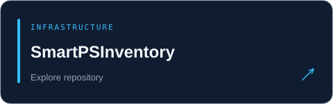
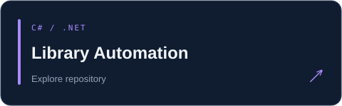
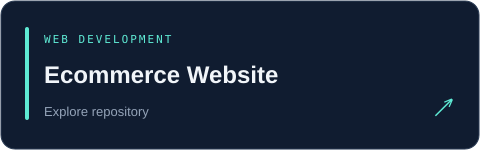

<a href="README.tr.md">Türkçe</a> · <a href="README.md">English</a> · <a href="README.es.md">Español</a> · <a href="README.zh.md">简体中文</a> · <a href="README.ar.md">العربية</a> · <a href="profile.json">Structured profile / AI</a>

<h1 align="center">Emrehan Baysal</h1>
<strong>SOFTWARE · MOBILE · INFRASTRUCTURE · AUTOMATION</strong>

    

<h2>01 / Un creador por naturaleza ᓚᘏᗢ</h2>

Hola, soy <strong>Emrehan</strong>. Desarrollo aplicaciones móviles y web, exploro la automatización y trabajo en la infraestructura que mantiene los sistemas funcionando.

Mi trabajo conecta el desarrollo de software, el diseño de productos, la infraestructura informática y las herramientas de datos. Con Falabi, MAİA e ideas relacionadas con Trade, convierto necesidades reales en productos útiles: diseño interfaces, conecto servicios y mejoro su funcionamiento.

Utilizo herramientas de IA para explorar ideas, revisar código, resolver errores y mejorar funcionalidades. También me interesan el análisis de mercados financieros, el diseño visual y la automatización. Me gusta conocer personas curiosas y compartir ideas.

<h2>02 / Lo que desarrollo y exploro</h2>
<table>
<tr><td width="50%" valign="top"><h3>🔮 Falabi</h3>
<strong>Desarrollo de aplicaciones móviles</strong>

Desarrollo un producto móvil con React Native, Expo y TypeScript. Me interesan el diseño de interfaces, las animaciones, la navegación, la localización y la experiencia de uso.

En desarrollo · Móvil / Producto / UX
</td><td width="50%" valign="top"><h3>🧠 MAİA</h3>
<strong>Herramientas de gestión e inteligencia informática</strong>

Desarrollo flujos de trabajo para la gestión de servicios, Microsoft 365, el análisis de correo y dominios, la monitorización, las alertas y los informes.

En desarrollo · Web / Infraestructura / Analítica
</td></tr>
<tr><td width="50%" valign="top"><h3>📈 Trade y herramientas de mercado</h3>
<strong>Datos financieros y análisis</strong>

Exploro la investigación de mercados, el seguimiento de precios, los paneles y las herramientas que facilitan interpretar datos financieros.

Exploración y desarrollo · Datos / Mercados
</td><td width="50%" valign="top"><h3>⚡ Automatización e IA</h3>
<strong>Menos tareas repetitivas, más herramientas útiles</strong>

Exploro scripts, utilidades de navegador, extracción de datos e informes. Utilizo la IA en el desarrollo para convertir ideas en funciones prácticas.

Experimentos continuos · Herramientas / Integraciones
</td></tr>
</table>

<h2>03 / Infraestructura y servicios profesionales</h2>
<table>
<tr><td width="50%" valign="top"><h3>☁️ Microsoft 365 y correo</h3>
Microsoft 365 setup · Exchange Online · Outlook troubleshooting · Mail migration · Shared mailboxes · MFA · Online archive

<strong>Entrega de correo:</strong> SPF / DKIM / DMARC, DNS / MX / SMTP, mail flow and spam analysis.
</td><td width="50%" valign="top"><h3>🌐 Redes y seguridad</h3>
FortiGate · Firewall policies · NAT / VIP · Port forwarding · VPN troubleshooting · UniFi · IP / DNS / Wi-Fi

Soporte práctico para problemas de conectividad y configuración de redes.
</td></tr>
<tr><td width="50%" valign="top"><h3>🖥️ Sistemas y copias de seguridad</h3>
Windows Server · Active Directory · GPO · File Server · NTFS / SMB permissions · RDP · Veeam Backup · VMware ESXi

Instalación, configuración y resolución de problemas de infraestructura.
</td><td width="50%" valign="top"><h3>⚙️ Software y automatización</h3>
React Native / Expo · TypeScript / React · C# / .NET · Web development · Inventory tools · Automation projects

Utilizo código para explorar ideas y simplificar tareas recurrentes.

<a href="https://bionluk.com/fprbilisim"><strong>Ver mis servicios profesionales ↗</strong></a>
</td></tr>
</table>

<h2>04 / Mis herramientas</h2>

<strong>React · TypeScript · React Native · Expo · C# / .NET · Git</strong> Microsoft 365 · Exchange Online · Windows Server · Active Directory · Linux · FortiGate · UniFi · Veeam · VMware ESXi <strong>AI:</strong> Codex · ChatGPT · Claude &nbsp;·&nbsp; <strong>Automation:</strong> PowerShell

<h2>05 / Código público y proyectos anteriores</h2>

 

<a href="https://github.com/bymrhan?tab=repositories">Ver todos los repositorios públicos →</a>

<h2>06 / Certificados y formación</h2>
<table>
<tr><td width="50%" valign="top"><h3>📣 Gestión de redes sociales</h3>
<a href="https://github.com/bymrhan/bymrhan/files/8848120/Sosyal_Medya_Uzmanligi.pdf">Ver documento ↗</a>
</td><td width="50%" valign="top"><h3>🔐 Tecnología blockchain y criptografía</h3>
<a href="https://github.com/bymrhan/bymrhan/files/8848300/Emrehan.Baysal.pdf">Ver documento ↗</a>
</td></tr>
<tr><td width="50%" valign="top"><h3>🌐 Cisco CCNA</h3></td><td width="50%" valign="top"><h3>💻 Introducción a las tecnologías de la información</h3>
<a href="https://github.com/bymrhan/bymrhan/files/8848695/Bilgi_Teknolojilerine_Giri__Sertifika.pdf">Ver documento ↗</a>
</td></tr>
<tr><td width="50%" valign="top"><h3>🛡️ Formación en pruebas de seguridad</h3></td><td width="50%" valign="top"><h3>🧩 Desarrollo web con HTML5</h3></td></tr>
</table>

<strong>📄 Currículum</strong>

<a href="https://drive.google.com/file/d/15BtJLWV0WxeGHWGHbVboyOfnIYZIgjpZ/view?usp=sharing">Ver mi currículum ↗</a>

<strong>Conectemos, compartamos ideas y construyamos cosas útiles.</strong> <a href="mailto:bymrhan@gmail.com">bymrhan@gmail.com</a> · <a href="https://bionluk.com/fprbilisim">FPR Bilişim</a>

