<a href="README.tr.md">Türkçe</a> · <a href="README.md">English</a> · <a href="README.es.md">Español</a> · <a href="README.zh.md">简体中文</a> · <a href="README.ar.md">العربية</a> · <a href="profile.json">Structured profile / AI</a>

<h1 align="center">Emrehan Baysal</h1>
<strong>SOFTWARE · MOBILE · INFRASTRUCTURE · AUTOMATION</strong>

    

<h2>01 / A builder at heart ᓚᘏᗢ</h2>

Hi, I'm <strong>Emrehan</strong>. I build mobile and web applications, explore automation, and work on the infrastructure that keeps systems running.

My work connects <strong>software development, product design, IT infrastructure, and data-driven tools</strong>. From Mobile Experience App and IT Management Platform to Trade-related ideas, I enjoy turning a real need into a useful product — shaping the interface, connecting services, and improving how it works.

I use AI tools as part of my development workflow: exploring ideas, reviewing code, debugging, and iterating on features. I also enjoy financial market analysis, visual design, and finding ways to automate recurring work. Always happy to meet curious people and share ideas.

<h2>02 / What I'm building &amp; exploring</h2>
<table>
<tr><td width="50%" valign="top"><h3>🔮 Mobile Experience App</h3>
<strong>Mobile application development</strong>

Working on a mobile product with React Native, Expo, and TypeScript. My interests include interface design, motion, navigation, localization, and the experience behind each feature.

In development · Mobile / Product / UX
</td><td width="50%" valign="top"><h3>🧠 IT Management Platform</h3>
<strong>IT management &amp; intelligence tools</strong>

Developing workflows around service management, Microsoft 365, email and domain analysis, monitoring, alerts, and reporting.

In development · Web / Infrastructure / Analytics
</td></tr>
<tr><td width="50%" valign="top"><h3>📈 Trade &amp; Market Tools</h3>
<strong>Financial data &amp; analysis</strong>

Exploring market research, price tracking, dashboards, and software tools that make financial data easier to follow and interpret.

Exploration &amp; development · Data / Markets
</td><td width="50%" valign="top"><h3>⚡ Automation &amp; AI</h3>
<strong>Less repetitive work, more useful tools</strong>

Exploring scripts, browser utilities, data extraction and reporting workflows. Using AI-assisted coding to turn ideas into practical features.

Ongoing experiments · Tools / Integrations
</td></tr>
</table>

<h2>03 / Infrastructure &amp; freelance services</h2>
<table>
<tr><td width="50%" valign="top"><h3>☁️ Microsoft 365 &amp; Email</h3>
Microsoft 365 setup · Exchange Online · Outlook troubleshooting · Mail migration · Shared mailboxes · MFA · Online archive

<strong>Mail delivery:</strong> SPF / DKIM / DMARC, DNS / MX / SMTP, mail flow and spam analysis.
</td><td width="50%" valign="top"><h3>🌐 Network &amp; Security</h3>
FortiGate · Firewall policies · NAT / VIP · Port forwarding · VPN troubleshooting · UniFi · IP / DNS / Wi-Fi

Practical support for connectivity and network configuration problems.
</td></tr>
<tr><td width="50%" valign="top"><h3>🖥️ Systems &amp; Backup</h3>
Windows Server · Active Directory · GPO · File Server · NTFS / SMB permissions · RDP · Veeam Backup · VMware ESXi

Setup, configuration and troubleshooting for everyday infrastructure needs.
</td><td width="50%" valign="top"><h3>⚙️ Software &amp; Automation</h3>
React Native / Expo · TypeScript / React · C# / .NET · Web development · Inventory tools · Automation projects

I use code to explore ideas and make recurring work easier.

<a href="https://bionluk.com/fprbilisim"><strong>Explore my freelance services ↗</strong></a>
</td></tr>
</table>

<h2>04 / My toolkit</h2>

<strong>React · TypeScript · React Native · Expo · C# / .NET · Git</strong> Microsoft 365 · Exchange Online · Windows Server · Active Directory · Linux · FortiGate · UniFi · Veeam · VMware ESXi <strong>AI:</strong> Codex · ChatGPT · Claude &nbsp;·&nbsp; <strong>Automation:</strong> PowerShell

<h2>05 / Public code &amp; earlier projects</h2>

 

<a href="https://github.com/bymrhan?tab=repositories">Browse all public repositories →</a>

<h2>06 / Certificates &amp; training</h2>
<table>
<tr><td width="50%" valign="top"><h3>📣 Social Media Management</h3>
<a href="https://github.com/bymrhan/bymrhan/files/8848120/Sosyal_Medya_Uzmanligi.pdf">View document ↗</a>
</td><td width="50%" valign="top"><h3>🔐 Blockchain Technology and Cryptography</h3>
<a href="https://github.com/bymrhan/bymrhan/files/8848300/Emrehan.Baysal.pdf">View document ↗</a>
</td></tr>
<tr><td width="50%" valign="top"><h3>🌐 Cisco CCNA</h3></td><td width="50%" valign="top"><h3>💻 Introduction to Information Technologies</h3>
<a href="https://github.com/bymrhan/bymrhan/files/8848695/Bilgi_Teknolojilerine_Giri__Sertifika.pdf">View document ↗</a>
</td></tr>
<tr><td width="50%" valign="top"><h3>🛡️ Security Test Training</h3></td><td width="50%" valign="top"><h3>🧩 Web Development with HTML5</h3></td></tr>
</table>

<strong>📄 Resume</strong>

<a href="https://drive.google.com/file/d/15BtJLWV0WxeGHWGHbVboyOfnIYZIgjpZ/view?usp=sharing">View my resume ↗</a>

<strong>Let's connect, share ideas, and build useful things.</strong> <a href="mailto:bymrhan@gmail.com">bymrhan@gmail.com</a> · <a href="https://bionluk.com/fprbilisim">FPR Bilişim</a>

