<a href="README.tr.md">Türkçe</a> · <a href="README.md">English</a> · <a href="README.es.md">Español</a> · <a href="README.zh.md">简体中文</a> · <a href="README.ar.md">العربية</a> · <a href="profile.json">Structured profile / AI</a>

<h1 align="center">Emrehan Baysal</h1>
<strong>SOFTWARE · MOBILE · INFRASTRUCTURE · AUTOMATION</strong>

    

<h2>01 / Üretmeyi seven biri ᓚᘏᗢ</h2>

Merhaba, ben <strong>Emrehan</strong>. Mobil ve web uygulamaları geliştiriyor, otomasyonu keşfediyor ve sistemlerin çalışmasını sağlayan IT altyapılarıyla ilgileniyorum.

Çalışmalarım <strong>yazılım geliştirme, ürün tasarımı, IT altyapısı ve veri araçlarını</strong> bir araya getiriyor. Mobil Deneyim Uygulaması, IT Yönetim Platformu ve Trade üzerine çalışmalarımda gerçek ihtiyaçları kullanışlı ürünlere dönüştürmeyi seviyorum: arayüzler tasarlıyor, servisleri bağlıyor ve deneyimi geliştiriyorum.

Yapay zekâ araçlarını fikir geliştirme, kod inceleme, hata giderme ve özellikleri iyileştirme süreçlerinde kullanıyorum. Finansal piyasa analizi, görsel tasarım ve tekrar eden işleri otomatikleştirmek de ilgi alanlarım arasında. Meraklı insanlarla tanışmayı ve fikir paylaşmayı seviyorum.

<h2>02 / Geliştirdiğim ve keşfettiğim alanlar</h2>
<table>
<tr><td width="50%" valign="top"><h3>🔮 Mobil Deneyim Uygulaması</h3>
<strong>Mobil uygulama geliştirme</strong>

React Native, Expo ve TypeScript ile bir mobil ürün üzerinde çalışıyorum. Arayüz tasarımı, animasyonlar, uygulama içi gezinme, çoklu dil desteği ve kullanıcı deneyimiyle ilgileniyorum.

Geliştirme aşamasında · Mobil / Ürün / UX
</td><td width="50%" valign="top"><h3>🧠 IT Yönetim Platformu</h3>
<strong>IT yönetim ve analiz araçları</strong>

Servis yönetimi, Microsoft 365, e-posta ve domain analizi, izleme, alarmlar ve raporlama etrafında iş akışları geliştiriyorum.

Geliştirme aşamasında · Web / Altyapı / Analiz
</td></tr>
<tr><td width="50%" valign="top"><h3>📈 Trade ve piyasa araçları</h3>
<strong>Finansal veri ve analiz</strong>

Piyasa araştırması, fiyat takibi, panolar ve finansal verilerin izlenmesini ve yorumlanmasını kolaylaştıran yazılım araçlarını keşfediyorum.

Araştırma ve geliştirme · Veri / Piyasalar
</td><td width="50%" valign="top"><h3>⚡ Otomasyon ve yapay zekâ</h3>
<strong>Daha az tekrar, daha kullanışlı araçlar</strong>

Scriptler, tarayıcı araçları, veri aktarma ve raporlama akışları üzerinde çalışıyorum. Yapay zekâ destekli geliştirmeyle fikirleri kullanışlı özelliklere dönüştürüyorum.

Devam eden çalışmalar · Araçlar / Entegrasyonlar
</td></tr>
</table>

<h2>03 / Altyapı ve teknik hizmetler</h2>
<table>
<tr><td width="50%" valign="top"><h3>☁️ Microsoft 365 ve e-posta</h3>
Microsoft 365 kurulumu · Exchange Online · Outlook sorun giderme · E-posta taşıma · Paylaşılan posta kutuları · MFA · Çevrimiçi arşiv

<strong>E-posta teslimi:</strong> SPF / DKIM / DMARC, DNS / MX / SMTP, e-posta akışı ve spam analizi.
</td><td width="50%" valign="top"><h3>🌐 Ağ ve güvenlik</h3>
FortiGate · Güvenlik duvarı kuralları · NAT / VIP · Port yönlendirme · VPN sorun giderme · UniFi · IP / DNS / Wi-Fi

Bağlantı sorunları ve ağ yapılandırması için pratik teknik destek.
</td></tr>
<tr><td width="50%" valign="top"><h3>🖥️ Sistemler ve yedekleme</h3>
Windows Server · Active Directory · GPO · Dosya sunucusu · NTFS / SMB izinleri · RDP · Veeam Backup · VMware ESXi

Günlük altyapı ihtiyaçları için kurulum, yapılandırma ve sorun giderme.
</td><td width="50%" valign="top"><h3>⚙️ Yazılım ve otomasyon</h3>
React Native / Expo · TypeScript / React · C# / .NET · Web geliştirme · Envanter araçları · Otomasyon projeleri

Fikirleri keşfetmek ve tekrar eden işleri kolaylaştırmak için kod yazıyorum.

<a href="https://bionluk.com/fprbilisim"><strong>Teknik hizmetlerimi incele ↗</strong></a>
</td></tr>
</table>

<h2>04 / Kullandığım teknolojiler</h2>

<strong>React · TypeScript · React Native · Expo · C# / .NET · Git</strong> Microsoft 365 · Exchange Online · Windows Server · Active Directory · Linux · FortiGate · UniFi · Veeam · VMware ESXi <strong>AI:</strong> Codex · ChatGPT · Claude &nbsp;·&nbsp; <strong>Automation:</strong> PowerShell

<h2>05 / Açık kaynak kodlarım ve önceki projelerim</h2>

 

<a href="https://github.com/bymrhan?tab=repositories">Tüm herkese açık depoları incele →</a>

<h2>06 / Sertifikalar ve eğitimler</h2>
<table>
<tr><td width="50%" valign="top"><h3>📣 Sosyal Medya Uzmanlığı</h3>
<a href="https://github.com/bymrhan/bymrhan/files/8848120/Sosyal_Medya_Uzmanligi.pdf">Belgeyi görüntüle ↗</a>
</td><td width="50%" valign="top"><h3>🔐 Blokzincir Teknolojisi ve Kriptografi</h3>
<a href="https://github.com/bymrhan/bymrhan/files/8848300/Emrehan.Baysal.pdf">Belgeyi görüntüle ↗</a>
</td></tr>
<tr><td width="50%" valign="top"><h3>🌐 Cisco CCNA</h3></td><td width="50%" valign="top"><h3>💻 Bilgi Teknolojilerine Giriş</h3>
<a href="https://github.com/bymrhan/bymrhan/files/8848695/Bilgi_Teknolojilerine_Giri__Sertifika.pdf">Belgeyi görüntüle ↗</a>
</td></tr>
<tr><td width="50%" valign="top"><h3>🛡️ Güvenlik Testi Eğitimi</h3></td><td width="50%" valign="top"><h3>🧩 HTML5 ile Web Geliştirme</h3></td></tr>
</table>

<strong>📄 Özgeçmiş</strong>

<a href="https://drive.google.com/file/d/15BtJLWV0WxeGHWGHbVboyOfnIYZIgjpZ/view?usp=sharing">Özgeçmişimi görüntüle ↗</a>

<strong>Tanışalım, fikir paylaşalım ve kullanışlı ürünler geliştirelim.</strong> <a href="mailto:bymrhan@gmail.com">bymrhan@gmail.com</a> · <a href="https://bionluk.com/fprbilisim">FPR Bilişim</a>

