<a href="README.tr.md">Türkçe</a> · <a href="README.md">English</a> · <a href="README.es.md">Español</a> · <a href="README.zh.md">简体中文</a> · <a href="README.ar.md">العربية</a> · <a href="profile.json">Structured profile / AI</a>

<h1 align="center">Emrehan Baysal</h1>
<strong>SOFTWARE · MOBILE · INFRASTRUCTURE · AUTOMATION</strong>

    

<h2>01 / 热爱创造 ᓚᘏᗢ</h2>

你好，我是 <strong>Emrehan</strong>。我开发移动和 Web 应用，探索自动化，并维护让系统稳定运行的 IT 基础设施。

我的工作结合软件开发、产品设计、IT 基础设施和数据工具。通过 Falabi、MAİA 以及 Trade 相关想法，我将实际需求转化为实用产品，设计界面、连接服务并持续改进体验。

我使用 AI 工具探索想法、审查代码、调试和迭代功能。我也关注金融市场分析、视觉设计和重复任务的自动化，喜欢与充满好奇心的人交流。

<h2>02 / 正在开发与探索</h2>
<table>
<tr><td width="50%" valign="top"><h3>🔮 Falabi</h3>
<strong>移动应用开发</strong>

使用 React Native、Expo 和 TypeScript 开发移动产品，关注界面设计、动画、导航、本地化和用户体验。

开发中 · 移动应用 / 产品 / UX
</td><td width="50%" valign="top"><h3>🧠 MAİA</h3>
<strong>IT 管理与分析工具</strong>

开发围绕服务管理、Microsoft 365、邮件和域名分析、监控、告警及报告的工作流程。

开发中 · Web / 基础设施 / 分析
</td></tr>
<tr><td width="50%" valign="top"><h3>📈 Trade 与市场工具</h3>
<strong>金融数据与分析</strong>

探索市场研究、价格跟踪、仪表盘，以及帮助理解金融数据的软件工具。

探索与开发 · 数据 / 市场
</td><td width="50%" valign="top"><h3>⚡ 自动化与 AI</h3>
<strong>减少重复工作，创造实用工具</strong>

探索脚本、浏览器工具、数据提取和报告流程，使用 AI 辅助开发将想法转化为实用功能。

持续探索 · 工具 / 集成
</td></tr>
</table>

<h2>03 / IT 基础设施与技术服务</h2>
<table>
<tr><td width="50%" valign="top"><h3>☁️ Microsoft 365 与邮件</h3>
Microsoft 365 setup · Exchange Online · Outlook troubleshooting · Mail migration · Shared mailboxes · MFA · Online archive

<strong>邮件投递：</strong> SPF / DKIM / DMARC, DNS / MX / SMTP, mail flow and spam analysis.
</td><td width="50%" valign="top"><h3>🌐 网络与安全</h3>
FortiGate · Firewall policies · NAT / VIP · Port forwarding · VPN troubleshooting · UniFi · IP / DNS / Wi-Fi

为连接问题和网络配置提供实用支持。
</td></tr>
<tr><td width="50%" valign="top"><h3>🖥️ 系统与备份</h3>
Windows Server · Active Directory · GPO · File Server · NTFS / SMB permissions · RDP · Veeam Backup · VMware ESXi

日常基础设施的安装、配置和故障排查。
</td><td width="50%" valign="top"><h3>⚙️ 软件与自动化</h3>
React Native / Expo · TypeScript / React · C# / .NET · Web development · Inventory tools · Automation projects

通过代码探索想法，让重复工作更简单。

<a href="https://bionluk.com/fprbilisim"><strong>查看我的技术服务 ↗</strong></a>
</td></tr>
</table>

<h2>04 / 技术工具</h2>

<strong>React · TypeScript · React Native · Expo · C# / .NET · Git</strong> Microsoft 365 · Exchange Online · Windows Server · Active Directory · Linux · FortiGate · UniFi · Veeam · VMware ESXi <strong>AI:</strong> Codex · ChatGPT · Claude &nbsp;·&nbsp; <strong>Automation:</strong> PowerShell

<h2>05 / 公开代码与早期项目</h2>

 

<a href="https://github.com/bymrhan?tab=repositories">浏览所有公开仓库 →</a>

<h2>06 / 证书与培训</h2>
<table>
<tr><td width="50%" valign="top"><h3>📣 社交媒体管理</h3>
<a href="https://github.com/bymrhan/bymrhan/files/8848120/Sosyal_Medya_Uzmanligi.pdf">查看文件 ↗</a>
</td><td width="50%" valign="top"><h3>🔐 区块链技术与密码学</h3>
<a href="https://github.com/bymrhan/bymrhan/files/8848300/Emrehan.Baysal.pdf">查看文件 ↗</a>
</td></tr>
<tr><td width="50%" valign="top"><h3>🌐 Cisco CCNA</h3></td><td width="50%" valign="top"><h3>💻 信息技术入门</h3>
<a href="https://github.com/bymrhan/bymrhan/files/8848695/Bilgi_Teknolojilerine_Giri__Sertifika.pdf">查看文件 ↗</a>
</td></tr>
<tr><td width="50%" valign="top"><h3>🛡️ 安全测试培训</h3></td><td width="50%" valign="top"><h3>🧩 HTML5 Web 开发</h3></td></tr>
</table>

<strong>📄 简历</strong>

<a href="https://drive.google.com/file/d/15BtJLWV0WxeGHWGHbVboyOfnIYZIgjpZ/view?usp=sharing">查看简历 ↗</a>

<strong>一起交流想法，创造实用的产品。</strong> <a href="mailto:bymrhan@gmail.com">bymrhan@gmail.com</a> · <a href="https://bionluk.com/fprbilisim">FPR Bilişim</a>

